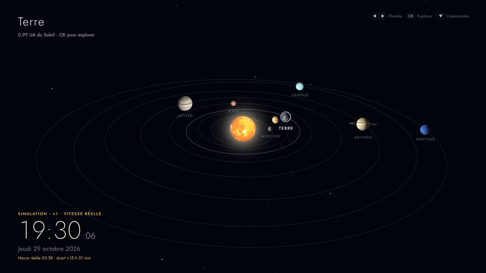
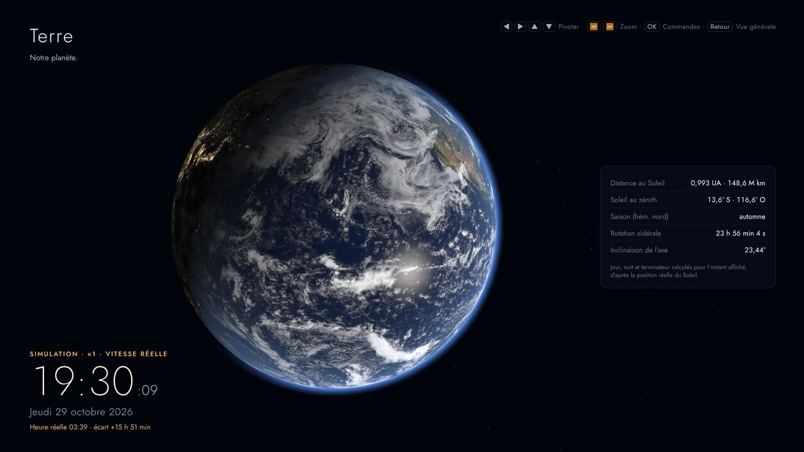
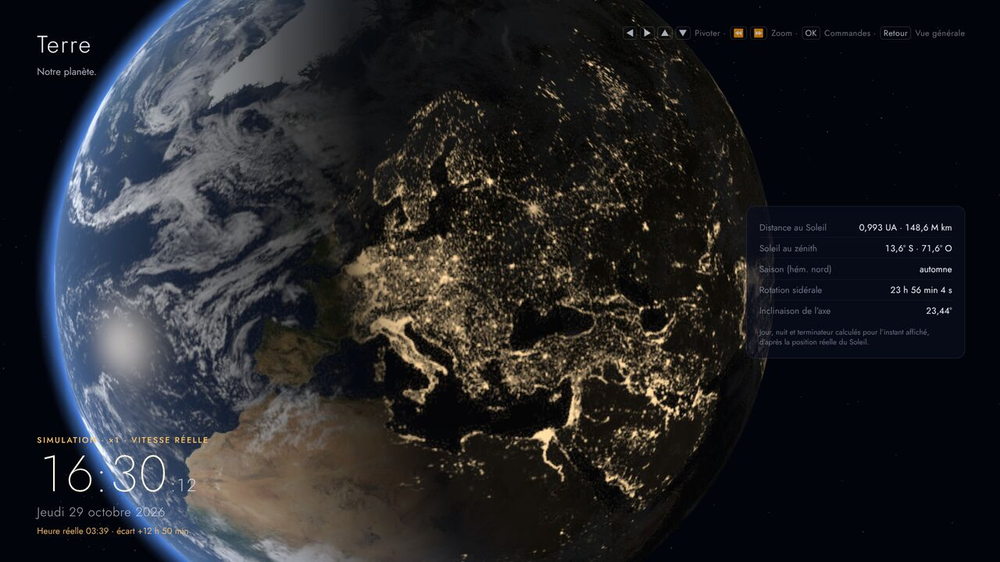

# Horloge Cosmique

Horloge astronomique interactive pour téléviseur (Amazon Fire TV Stick) : le
système solaire en 3D, avec les planètes **à leur position angulaire réelle**
autour du Soleil, et une Terre détaillée dont le **jour et la nuit sont calculés
pour l'heure qu'il est**.



| Terre (vue rapprochée) | Europe au crépuscule (exploration régionale) |
|---|---|
|  |  |

> Les captures ci-dessus ont été réalisées en **mode simulation** (heure
> choisie), ce qu'indiquent le bandeau orangé « Simulation » et la ligne
> « Heure réelle » sous l'horloge.

## Ce que fait l'application

- **Vue générale** : le Soleil et les huit planètes en 3D, en perspective
  légèrement inclinée, sur fond d'étoiles réelles (5 044 étoiles du catalogue
  Hipparcos/XHIP). Les **directions** des planètes vues du Soleil (longitude et
  latitude héliocentriques) sont exactes ; les **distances et les tailles** sont
  adaptées à l'écran (elles ne sont pas à l'échelle, et l'application ne le
  prétend pas). Les orbites tracées sont les vraies ellipses, transformées de la
  même manière que les planètes.
- **Horloge** : heure locale, jour de la semaine et date, en français. Si une
  simulation est active (accélération, pause, autre date), un bandeau
  « Simulation » l'indique et l'heure réelle reste affichée.
- **Terre** : textures NASA (Blue Marble, Black Marble), nuages, reflet du Soleil
  sur les océans, halo atmosphérique, lumières des villes uniquement côté nuit.
  L'éclairage et le terminateur découlent de la position réelle du Soleil et de
  la rotation de la Terre (temps sidéral, précession).
- **Exploration** : sélection d'une planète à la télécommande, vue rapprochée,
  rotation de la caméra autour du globe, zoom, recentrage, et choix d'une région
  (Europe, France, Afrique, Asie, Amériques, Océanie, pôles…). La caméra est
  indépendante de la rotation du globe : la faire tourner ne change jamais
  l'éclairage.
- **Temps** : temps réel par défaut ; pause, accélération de ×60 à ×2 629 800
  (un mois par seconde) et retour à l'heure actuelle.
- **Fonctionnement hors ligne** : toutes les ressources sont embarquées.

## État du projet

| Élément | État |
|---|---|
| Application web (TypeScript, Vite, Three.js) | ✅ fonctionnelle, testée dans Chromium |
| Modèle astronomique | ✅ 143 tests unitaires, comparé à une bibliothèque de référence |
| Vérification de bout en bout (rendu, navigation, terminateur) | ✅ 22/22 contrôles dans Chromium (WebGL logiciel) |
| Projet Android (WebView) pour Fire TV | ✅ code complet, compilé et signé |
| Compilation de l'APK avec Gradle | ✅ réussie par l'intégration continue GitHub (plugin Android 8.7.3, Gradle 8.11.1) ; APK téléchargeable dans l'onglet *Actions* |
| Essai sur un vrai Fire TV Stick | ❌ non réalisé (aucun appareil disponible) — voir [la liste des vérifications restantes](docs/TESTS.md#ce-qui-reste-à-vérifier-sur-le-fire-tv-réel) |

Détail des résultats : [docs/TESTS.md](docs/TESTS.md).

## Démarrage rapide sur un PC (Windows, macOS ou Linux)

### 1. Installer les prérequis (une seule fois)

1. **Git** : https://git-scm.com/downloads
2. **Node.js 22 LTS** (ou 24 LTS) : https://nodejs.org — version 22.12 minimum.
   Vérification dans un terminal : `node --version` doit afficher `v22.12` ou plus.
3. **Visual Studio Code** : https://code.visualstudio.com

### 2. Récupérer le projet

Dans un terminal (sous Windows : « Terminal » ou « Invite de commandes ») :

```bash
git clone https://github.com/mymypav-max/horloge-cosmique.git
cd horloge-cosmique
code .
```

La dernière commande ouvre le dossier dans VS Code (sinon : *Fichier › Ouvrir
le dossier…*). VS Code peut proposer d'installer les extensions recommandées
(Vitest, EditorConfig) : acceptez.

### 3. Installer les dépendances et lancer

Dans le terminal intégré de VS Code (*Affichage › Terminal*) :

```bash
npm install
npm run dev
```

Ouvrez ensuite l'adresse affichée (en général http://localhost:5173) dans
Chrome, Edge ou Firefox. L'adresse « Network » affichée permet aussi d'ouvrir
l'application depuis un autre appareil du réseau local.

### Commandes utiles

| Commande | Rôle |
|---|---|
| `npm run dev` | serveur de développement avec rechargement automatique |
| `npm test` | tests unitaires (modèle astronomique, navigation, temps, scène…) |
| `npm run typecheck` | vérification des types TypeScript |
| `npm run build` | compilation de production dans `dist/` (nécessaire avant l'APK) |
| `npm run preview` | sert la version compilée (`dist/`) |
| `npm run test:e2e` | vérification de bout en bout dans Chromium (après `npm run build` et, une fois, `npx playwright install chromium`) |

### Paramètres d'adresse (démonstration, tests)

| Paramètre | Effet |
|---|---|
| `?t=2024-06-20T20:51:00Z` | démarre une simulation à cet instant (en pause) |
| `&vitesse=3600` | démarre la simulation à ×3600 au lieu de la pause |
| `&vue=terre` | ouvre directement la vue rapprochée d'une planète |
| `&qualite=economy`, `standard` ou `high` | force un niveau de qualité |
| `&debug=1` | affiche la cadence d'images et expose une API de test |

Exemple : http://localhost:5173/?t=2024-06-20T12:00:00Z&vue=terre (solstice d'été).

## Commandes au clavier et à la télécommande

| Action | Télécommande Fire TV | Clavier |
|---|---|---|
| Choisir une planète (vue générale) | ◀ ▶ | ← → |
| Ouvrir la vue rapprochée | OK | Entrée |
| Faire pivoter la caméra (vue rapprochée) | ◀ ▶ ▲ ▼ (maintenir) | flèches |
| Zoomer / dézoomer (vue rapprochée) | ⏩ / ⏪ | `+` / `-` ou Page préc. / suiv., molette |
| Barre de commandes | ▼ (vue générale) ou OK (vue rapprochée), ou ☰ Menu | ↓ / Entrée, `M` |
| Régions de la Terre | barre › « Régions » | idem |
| Retour / fermer | Retour | Échap ou Retour arrière |
| Pause / reprise du temps | ⏯ | Espace |
| Ralentir / accélérer le temps (vue générale) | ⏪ / ⏩ | `-` / `+` |
| Revenir à l'heure actuelle | barre › « Maintenant » | idem |
| Quitter (Fire TV) | Retour deux fois en vue générale | — |

Sans action pendant 12 secondes, l'interface s'efface (mode horloge) : seules
l'heure et la date restent affichées.

## Installer sur un Fire TV Stick

Résumé (détails, compatibilité et dépannage : **[docs/FIRE-TV.md](docs/FIRE-TV.md)**) :

1. Compiler l'application web : `npm run build`.
2. Compiler l'APK : ouvrir le dossier `android/` dans Android Studio puis
   *Build › Build App Bundle(s) / APK(s) › Build APK(s)*, ou en ligne de
   commande `cd android` puis `./gradlew assembleDebug` (`gradlew.bat` sous
   Windows). Fichier produit : `android/app/build/outputs/apk/debug/app-debug.apk`.
3. Sur le Fire TV : activer les options pour développeurs, le débogage ADB et
   l'installation d'applications inconnues.
4. Installer avec `adb connect <adresse IP du Fire TV>` puis
   `adb install -r app-debug.apk`, ou télécharger l'APK avec l'application
   « Downloader ».

> **Attention** : les modèles fonctionnant sous **Vega OS** (par exemple le Fire
> TV Stick 4K Select de 2025) n'acceptent pas les applications Android. Voir
> [docs/FIRE-TV.md](docs/FIRE-TV.md#compatibilité).

## Structure du dépôt

```
horloge-cosmique/
├── index.html, src/            application web (TypeScript)
│   ├── astro/                  modèle astronomique (temps, éphémérides, repères, Terre)
│   ├── data/                   données : éléments orbitaux, planètes, régions, étoiles
│   ├── representation/         passage des données astronomiques aux grandeurs visuelles
│   ├── scene/                  moteur graphique Three.js (objets, shaders, textures)
│   ├── camera/                 caméra : vue générale, transitions, orbite, régions
│   ├── input/                  touches et machine d'états de navigation
│   ├── time/                   temps réel / simulé
│   ├── ui/                     interface (horloge, barre, panneaux, mise en forme FR)
│   ├── perf/                   qualité graphique, cadence, résolution dynamique
│   ├── platform/               pont avec l'application Android
│   └── app/                    orchestration, réglages, paramètres de démarrage
├── public/textures/            textures embarquées (provenance : docs/RESSOURCES.md)
├── tests/                      tests unitaires (Vitest)
├── scripts/                    préparation des ressources, vérification de bout en bout
├── android/                    projet Android Studio (WebView) pour Fire TV
├── docs/                       documentation
└── .github/workflows/          intégration continue (tests, APK)
```

## Documentation

- [Architecture et choix techniques](docs/ARCHITECTURE.md)
- [Modèle astronomique, conventions et limites de précision](docs/MODELE-ASTRONOMIQUE.md)
- [Fire TV : compatibilité, compilation, installation, dépannage](docs/FIRE-TV.md)
- [Tests : résultats réels et vérifications restantes](docs/TESTS.md)
- [Ressources graphiques : provenance et licences](docs/RESSOURCES.md)

## Licences

- Textures des planètes et du Soleil : © Solar System Scope, **CC BY 4.0**
  (attribution affichée dans l'application). Textures de la Terre : NASA,
  domaine public. Catalogue d'étoiles : XHIP via d3-celestial (BSD-3-Clause).
  Police Jost : SIL OFL 1.1. Détails : [docs/RESSOURCES.md](docs/RESSOURCES.md).
- Aucune licence n'a encore été choisie pour le code de ce dépôt : par défaut,
  tous les droits sont réservés à son propriétaire. Ajoutez un fichier `LICENSE`
  si vous souhaitez autoriser sa réutilisation.
